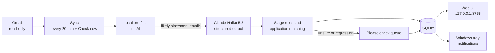

# Placement Tracker

A small Windows desktop app that reads my Gmail inbox, works out which emails are about my placement applications, and keeps one up-to-date record per application. It shows what needs doing first (tests to take, interviews to book, deadlines) and sends Windows notifications so nothing is forgotten.

I built it because I kept losing track of applications in my inbox. Confirmations, test invites, interview requests and rejections were buried among everything else, and I had applied to some companies without remembering. It runs entirely on my own laptop. It is a Java 21 / Spring Boot project and doubles as a portfolio piece.

## Features

- Reads Gmail with a **read-only** scope. It never sends, deletes, moves or marks mail.
- Scans every folder except Sent, Drafts and Trash (including Spam and Promotions, where recruiter emails often land).
- A cheap local pre-filter drops obvious noise before anything reaches the AI. It is deliberately conservative: when unsure, an email goes on.
- Claude classifies the remaining emails and extracts company, role, stage, deadlines and the action required.
- One record per application, with stages Applied, Online test, Interview, Assessment centre (active) and Offer, Rejected, Withdrawn (closed). Interview rounds are counted.
- **Stage rules:** the app never moves an application backwards on its own. Anything doubtful goes to a **Please check** queue instead of being dropped or guessed.
- **Needs action** list with colour-coded deadlines, plus a donut chart and a board by stage.
- Catch-up sync: processed messages are tracked, so downtime never causes emails to be skipped.
- Windows tray icon and notifications for new to-dos, deadlines 3 days and 1 day away, and Please check items.
- Manual control: edit any field, add applications by hand, merge duplicates. Fields you edit are never silently overwritten by the AI.
- Light and dark mode follow Windows.

## Screenshots

<!-- OWNER: take screenshots using the fake seed data (see "Trying the UI with fake data" below), never real email, and drop them into docs/screenshots/. Then link them here, e.g.  -->

_Screenshots to be added._

## Architecture



The UI is served only on `127.0.0.1`, and state-changing requests need a custom header, so other sites or devices cannot talk to it. Mail access sits behind a `MailSource` interface, so another provider would be straightforward to add.

## Tech stack

- Java 21, Spring Boot 4, Maven (with the Maven wrapper)
- SQLite with Flyway migrations
- Google API Java client (Gmail, `gmail.readonly`)
- Anthropic Java SDK (Claude Haiku 5.5, structured output)
- Plain HTML, CSS and JavaScript front end (no build step, no Node.js), with an inline SVG chart
- Windows DPAPI (via JNA) to encrypt the stored Gmail token
- JUnit 5, Mockito and Spring Boot test support

## Privacy

- For emails that pass the local pre-filter, **only the sender, subject, date and body text** are sent to Anthropic for classification. Attachments are not sent.
- Everything else stays on your laptop. There is no server and no analytics.
- Data lives in `%LOCALAPPDATA%\PlacementTracker`: the SQLite database (`tracker.db`), the Google client secret, the Gmail token (encrypted with Windows DPAPI for your Windows user), the optional `config.properties` and the `logs` folder.
- None of this is in the repository. `.gitignore` covers the database, tokens, config and any real-email test fixtures.

## Setup

You need Windows, a Gmail account, and an Anthropic API account.

The shell snippets below (`./mvnw ...`, `D=$(mktemp -d)`) are for **Git Bash**. In PowerShell or Command Prompt use `mvnw.cmd` instead of `./mvnw`.

### 1. JDK 21 or newer

Install a JDK (21+) and check `java -version`.

### 2. Google Cloud (one-off)

1. Go to <https://console.cloud.google.com> and create a new project (for example "Placement Tracker").
2. APIs & Services > Library: enable the **Gmail API**.
3. APIs & Services > OAuth consent screen: choose user type **External**, fill in the app name and your email, add your Gmail address as a **Test user**, and optionally add the `gmail.readonly` scope.
4. Set the publishing status to **In production**. Otherwise refresh tokens expire after about 7 days. At sign-in Google will warn that the app is unverified; choose Advanced > Go to app. That is fine for a personal app that only you use.
5. APIs & Services > Credentials > Create credentials > **OAuth client ID** > application type **Desktop app**. Download the JSON.
6. Google names the download `client_secret_<long id>.json`. **Rename it** to `google-client-secret.json` and save it as `%LOCALAPPDATA%\PlacementTracker\google-client-secret.json` (create the folder if needed). If the file is missing, the setup page says exactly where it should go.

### 3. Anthropic API key

Create a key in the Anthropic Console (the API is pay-as-you-go and separate from a Claude subscription), then provide it either way:

- set the environment variable `ANTHROPIC_API_KEY`, or
- add this line to `%LOCALAPPDATA%\PlacementTracker\config.properties`:

  ```
  anthropic.api-key=YOUR_KEY_HERE
  ```

**Restart the app after adding the key.** Until then, emails are queued and the UI shows a banner; they are read once a key is present.

### 4. Build and run

```bash
./mvnw package
java -jar target/placement-tracker-*.jar
```

Open <http://127.0.0.1:8765>. The setup page has a **Connect Gmail** button that opens Google's consent screen in your browser. After that, the first sync backfills mail from **1 June 2026** and then checks every 20 minutes (or press **Check now**). A tray icon appears; use it to open the tracker or quit.

### Reconnecting Gmail

If Google stops accepting the stored sign-in (for example you revoked access, changed your password, or the consent screen was left in Testing so the token expired after 7 days), the dashboard shows **"GMAIL needs reconnecting"**. Click **Open setup**, then **Reconnect**: it is one click and a fresh Google sign-in. The old token is discarded first, including one that can no longer be decrypted (for example after a Windows profile change). Nothing is lost while disconnected: the next sync after reconnecting catches up from where it stopped. If the sign-in fails, the setup page shows why.

### Blocked senders and the pre-filter replay

Before an email goes to Claude, a local pre-filter drops obvious noise. Keywords match whole words only. To stop specific senders (for example a shop's newsletters) ever reaching Claude, create `blocked-senders.txt` in the data folder (`%LOCALAPPDATA%\PlacementTracker`). Put one address or domain per line; a domain also covers its subdomains. Lines starting with `#` and blank lines are ignored, and case does not matter. Changes take effect on restart. A missing file is fine. Mail from a blocked sender is dropped even if it comes from a job-board domain, so only list senders that never send applications.

To check that the current rules would not have dropped any email that mattered, replay your stored emails through the filter. It only reads (it fetches message bodies from Gmail and changes nothing), then exits. Stop the tracker first if you can (both share Gmail's per-user limits); it is safe either way. Otherwise run it on another port:

```bash
./mvnw spring-boot:run -Dspring-boot.run.arguments="--tracker.dev.prefilter-replay=true --server.port=0 --tracker.sync.scheduler-enabled=false"
```

The log ends with a line such as `prefilter-replay: 5900 replayed; 900 still sent to AI, 5000 now filtered; relevant (PROCESSED/REVIEW/linked) dropped: 0`. Anything other than 0 is followed by one line per email to look at.

### Logs

The app writes its log to `%LOCALAPPDATA%\PlacementTracker\logs\tracker.log` (next to the database; it rolls over at 10 MB and keeps 14 files). Look there first if something seems off, for example the AI or Gmail being unavailable. The dashboard also shows a banner when the AI is failing and how many emails are waiting for it; **Try again** on a "Could not be read" item queues it for another attempt.

## Expected cost

Claude Haiku 5.5 costs $0.10 per million input tokens and $0.50 per million output tokens. A typical email is a few hundred to a couple of thousand tokens, and only emails that pass the pre-filter are sent. As a rough estimate, classifying around 1,000 emails should cost **well under $1**. This is an estimate, not a guarantee; check your usage in the Anthropic Console.

## Running the tests

```bash
./mvnw test
```

No network, Google account or API key is needed, and the tests never create or change anything in your real `%LOCALAPPDATA%\PlacementTracker` (each test context uses a throwaway temp folder; the eval below only reads your `config.properties` for the key). The classification eval set (50 synthetic emails across the four sources and every stage, plus look-alikes that should be ignored) calls the real API, so it is excluded by default. To run it you need a key:

```bash
./mvnw test -Peval
```

It prints a table of results and checks recall and stage accuracy. Without a key it skips itself. If you add real emails as test cases, put them in `src/test/resources/eval/private/`, which is git-ignored.

## Trying the UI with fake data

To see the app populated without connecting anything, start it with sample data and a throwaway data directory (so your real data is untouched):

```bash
D=$(mktemp -d)
./mvnw -q spring-boot:run -Dspring-boot.run.arguments="--tracker.dev.seed=true --tracker.data-dir=$D"
```

Or, with the built jar:

```bash
java -jar target/placement-tracker-*.jar --tracker.dev.seed=true --tracker.data-dir=<some temp folder>
```

Then open <http://127.0.0.1:8765>. All company names in the sample data are made up.

## Optional: start automatically at login

`start-tracker.bat` in the repo root runs the built jar with `javaw` (no console window). It finds the jar relative to its own location, so keep it next to `target/`. Edit the jar file name inside it if you build a different version.

To start with Windows:

1. Press `Win + R`, type `shell:startup` and press Enter.
2. Right-click `start-tracker.bat` > Show more options > Create shortcut, and move the shortcut into the Startup folder.

To remove it, delete that shortcut from the Startup folder. To stop a running copy, use the tray icon's **Quit**.

## Known limitations

- **Gmail only.** The `MailSource` interface keeps other providers possible, but none is built.
- **Windows only.** The tray icon, notifications and the DPAPI token encryption assume Windows.
- **Backfill starts on 1 June 2026.** Older mail is not scanned, and after that only new mail is picked up automatically. The date is configurable (`tracker.sync.backfill-from`). A large backfill is fetched oldest first in batches of 500 messages (`tracker.gmail.max-messages-per-run`) at no more than 10 Gmail requests per second (`tracker.gmail.max-requests-per-second`), so the first sync can take several minutes; Gmail rate-limit errors are retried automatically.
- **Accuracy depends on the model.** The "Please check" queue catches uncertain cases, but a wrong classification with high confidence is still possible, so glance at the board now and then.
- It is a single-user local tool: no accounts, hosting or mobile access.
- Some parts could only be checked by hand on a real machine (the tray icon, notification clicks, the live Gmail sign-in and the browser UI).

## Project layout

```
src/main/java/com/placementtracker/
  mail/         MailSource interface, Gmail source, token store, pre-filter
  classify/     Anthropic client, prompt and result parsing
  processing/   email -> application pipeline
  matching/     linking an email to an existing application
  application/  applications, stages, stage rules, actions, history
  review/       the Please check queue
  sync/         scheduled and manual sync, catch-up
  notify/       tray icon, notifications, reminders
  web/          REST API for the UI
src/main/resources/static/   the web UI
src/test/                    unit, integration and eval tests
docs/                        design spec
```
